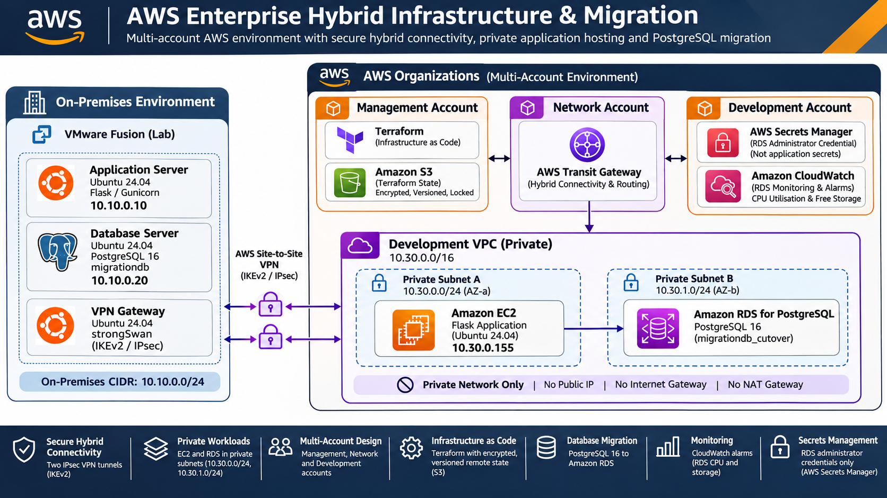
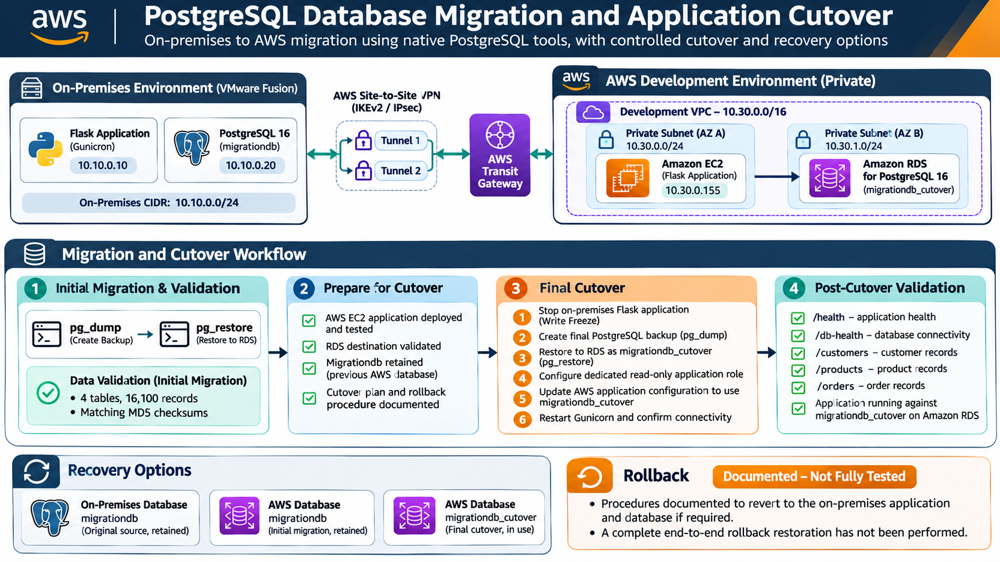

# AWS Enterprise Hybrid Infrastructure & Migration

**AWS Solutions Architecture | Hybrid Networking | Infrastructure as Code | Database Migration**

A hands-on enterprise hybrid infrastructure and migration project integrating an independently hosted VMware environment with a multi-account AWS environment in `eu-west-2`.

The project demonstrates secure hybrid connectivity, private application hosting, PostgreSQL database migration, controlled application cutover, infrastructure automation and operational recovery planning.

## Architecture Overview

*Figure 1: Multi-account AWS hybrid architecture connecting VMware-hosted application and database workloads to private AWS infrastructure through Site-to-Site VPN and Transit Gateway.*

[View full-size architecture diagram](docs/diagrams/hybrid-architecture-16x9.png)

The source environment runs on VMware Fusion, hosted on an Intel MacBook Pro, with three Ubuntu Server 24.04 virtual machines.

The AWS environment uses separate Management, Network and Development accounts, with AWS Transit Gateway providing connectivity between the on-premises network and private Development workloads.

### On-Premises Environment

| Component | Technology | Function |
|---|---|---|
| Application server | Ubuntu 24.04, Flask, Gunicorn | Source application |
| Database server | Ubuntu 24.04, PostgreSQL 16 | Source relational database |
| VPN gateway | Ubuntu 24.04, strongSwan | IPsec connectivity to AWS |
| Virtualisation | VMware Fusion | Independent on-premises infrastructure |

On-premises network: `10.10.0.0/24`

### AWS Environment

| Component | AWS Service | Function |
|---|---|---|
| Multi-account structure | AWS Organizations | Management and workload isolation |
| Hybrid routing | AWS Transit Gateway | On-premises-to-VPC connectivity |
| VPN connectivity | AWS Site-to-Site VPN | Two IPsec tunnels |
| Application hosting | Amazon EC2 | Private Ubuntu application server |
| Database | Amazon RDS for PostgreSQL 16 | Managed relational database |
| Network isolation | Amazon VPC | Private subnets across two Availability Zones |
| Access control | IAM and security groups | Workload access restrictions |
| Secret management | AWS Secrets Manager | RDS administrator credentials |
| Monitoring | Amazon CloudWatch | RDS CPU and storage alarms |
| Recovery | RDS backups and snapshots | Database recovery mechanisms |
| Infrastructure automation | Terraform | Version-controlled AWS infrastructure |

AWS Development VPC: `10.30.0.0/16`

## Hybrid Connectivity

Implemented a policy-based IPsec Site-to-Site VPN between an on-premises strongSwan gateway and AWS Transit Gateway.

Key implementation details:

- Two independently configured AWS VPN tunnels.
- Static routing between the on-premises subnet and AWS Development VPC.
- Private EC2 access through the VPN.
- No public IP address assigned to the application instance.
- No Internet Gateway or NAT Gateway deployed in the Development VPC.
- Manual VPN tunnel failover tested successfully.

**Limitation:** Both VPN tunnels were tested, but automatic tunnel failover is not configured.

## PostgreSQL Database Migration

Migrated an on-premises PostgreSQL 16 database to Amazon RDS for PostgreSQL 16 using native PostgreSQL backup and restore utilities.

### Migration and Cutover Architecture

*Figure 2: Initial database migration and integrity validation, controlled final cutover, and retained recovery options. Rollback procedures are documented but have not undergone a complete end-to-end test.*

[View full-size migration and cutover diagram](docs/diagrams/migration-cutover-16x9.png)

### Migration Approach

1. Prepared the source PostgreSQL database.
2. Established private database connectivity over the Site-to-Site VPN.
3. Created a custom-format PostgreSQL backup using `pg_dump`.
4. Restored the database into Amazon RDS using `pg_restore`.
5. Validated migrated records using row counts and checksums.
6. Stopped the on-premises Flask application for final cutover.
7. Created a final source database backup.
8. Restored the final backup into `migrationdb_cutover`.
9. Granted a dedicated application role read-only access.
10. Switched the AWS application to the final database.
11. Restarted Gunicorn and confirmed connectivity to the cutover database.

### Data Validation

| Table | Records |
|---|---:|
| customers | 1,000 |
| products | 100 |
| orders | 5,000 |
| order_items | 10,000 |
| **Total** | **16,100** |

The initial migration was validated using matching table counts and four source-to-target MD5 checksums.

The final cutover used a separate restored database to retain the earlier AWS migration database as a recovery option. Connectivity to `migrationdb_cutover` was confirmed; a separate full checksum audit of the final cutover database was not performed.

## Application Migration

Migrated the Flask application from the on-premises Ubuntu server to a private Ubuntu EC2 instance (`10.30.0.155`).

Implementation included:

- Python 3.12 virtual environment.
- Offline Python dependency installation.
- Flask REST API.
- Gunicorn application server.
- systemd service management.
- Environment-based application configuration.
- PostgreSQL connectivity using psycopg.
- TLS verification for RDS connections.
- Dedicated read-only database credentials.

Because the EC2 instance has no direct internet access, application files and Python dependencies were transferred from the on-premises environment over the VPN.

### Application Endpoints

| Endpoint | Purpose |
|---|---|
| `/health` | Application health |
| `/db-health` | Database connectivity |
| `/customers` | Customer records |
| `/products` | Product records |
| `/orders` | Order records |

Application connectivity and database-backed endpoints were tested against the initial AWS migration database over the hybrid network. After final cutover, `/db-health` was successfully verified against `migrationdb_cutover`.

A separate full post-cutover retest of all data endpoints has not been recorded.

## Infrastructure as Code

Terraform is used to manage AWS networking and application infrastructure, including:

- Transit Gateway and associated routing.
- VPC and private subnets.
- Route tables and Transit Gateway attachment.
- Private EC2 instances.
- EC2 security groups.
- SSH public key registration.
- RDS PostgreSQL instance.
- RDS subnet groups and access rules.

Remote Terraform state is stored in a versioned, encrypted S3 backend with native state locking.

Some supporting infrastructure and operational changes were configured separately using AWS CLI and manual administration. The repository does not claim that every deployed resource is Terraform-managed.

## Security Architecture

Implemented controls include:

- AWS account separation.
- Private application and database hosting.
- Security-group-based network access restrictions.
- No direct public exposure of application or database resources.
- Encrypted AWS Site-to-Site VPN connectivity.
- EBS and RDS storage encryption.
- TLS-verified application-to-database connections.
- Read-only PostgreSQL application role.
- RDS administrator password managed by Secrets Manager.
- SSH key authentication.
- Restrictive application environment-file permissions.
- IMDSv2 required on the application EC2 instance.

The application database password is maintained separately from the RDS administrator credential.

**Operational note:** The lab application uses a protected local environment file. A production implementation would integrate workload identity and centralised secrets retrieval.

## Resilience, Recovery and Monitoring

### VPN Resilience

Both configured VPN tunnels were independently tested, including manual failover and restoration.

Automatic failover is a future improvement.

### Database Recovery

- Seven-day RDS automated backup retention.
- Manual post-cutover RDS snapshot requested.
- Original on-premises database retained.
- Previous AWS migration database retained.
- Final cutover database isolated from the earlier migration.

A manual snapshot provides a recovery point once its status becomes `available`. Restoration from that snapshot has not been exercised.

The rollback procedure is documented in the migration runbook but has not been validated through a complete end-to-end exercise.

### Amazon CloudWatch

Configured RDS alarms for:

- CPU utilisation above 80% for two consecutive five-minute periods.
- Free storage below 5 GiB for one five-minute period.

Alarm notifications through Amazon SNS have not yet been configured.

## Migration Outcome

The project established a functional hybrid AWS environment and migrated a Flask/PostgreSQL workload from VMware-hosted Ubuntu servers into private AWS infrastructure.

Demonstrated capabilities include:

- Multi-account cloud networking.
- AWS Transit Gateway and IPsec VPN integration.
- Private workload deployment.
- Offline software deployment into isolated subnets.
- PostgreSQL database migration and integrity validation.
- Controlled application cutover.
- Least-privilege database access.
- Manual network failover.
- Infrastructure automation.
- Monitoring and operational recovery planning.

## Known Limitations and Future Improvements

- Implement automatic VPN tunnel failover.
- Test restoration of an RDS snapshot to a separate recovery instance.
- Complete post-cutover functional regression testing.
- Exercise the documented end-to-end rollback procedure.
- Add SNS alarm notifications.
- Move application secrets to a centrally managed secret store.
- Automate application deployment through CI/CD.
- Add centralised application logging.
- Consider Multi-AZ RDS and application redundancy for higher availability.
- Expand cost monitoring and operational runbooks.

## Documentation

- [GitHub setup](docs/github-setup.md)
- [Terraform workflow](docs/terraform-workflow.md)
- [Architecture Decision Records](docs/adr/)
- [Migration and Recovery Runbook](docs/migration/migration-runbook.md)

## Project Isolation

This implementation is isolated from other AWS portfolio projects.

Separate AWS accounts, CLI profiles, Terraform working directories and remote-state paths are used to minimise cross-project impact.

No credentials, private keys, Terraform state files or environment secrets should be committed to the repository.